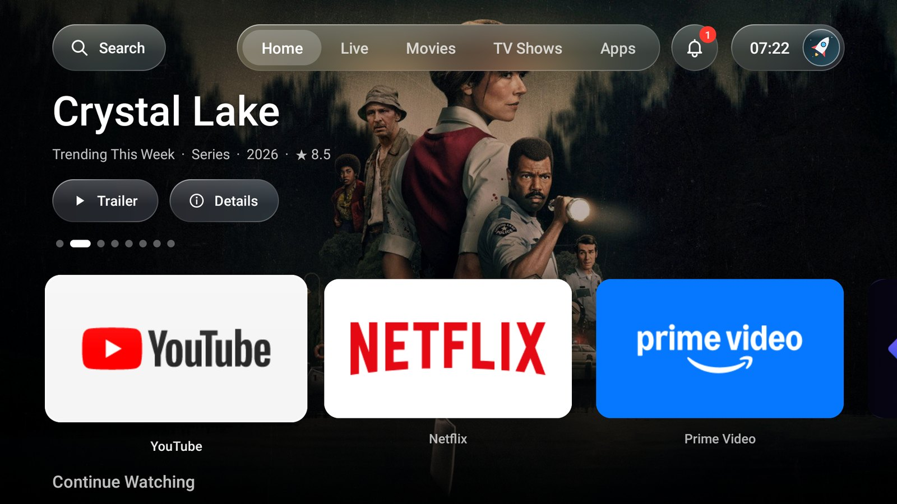
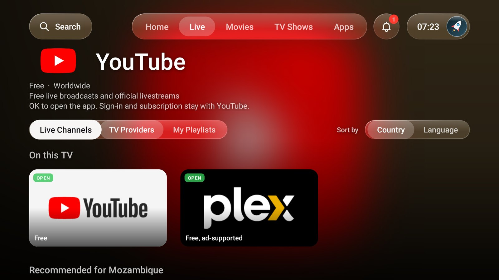
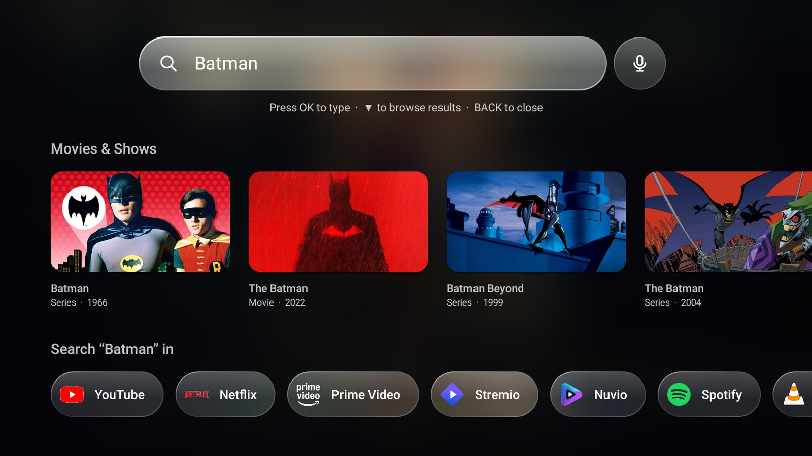
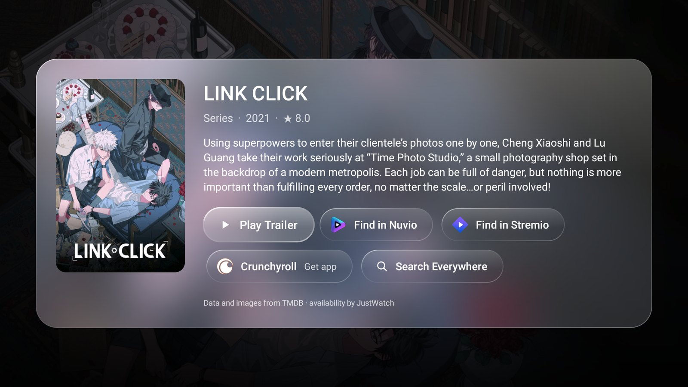
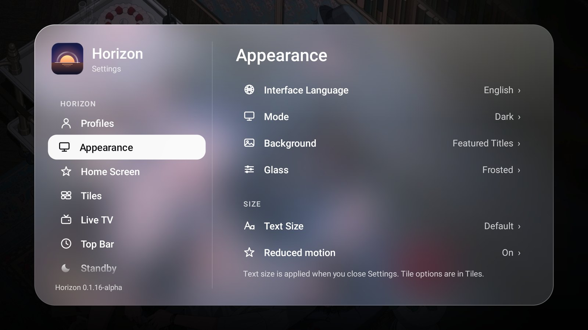
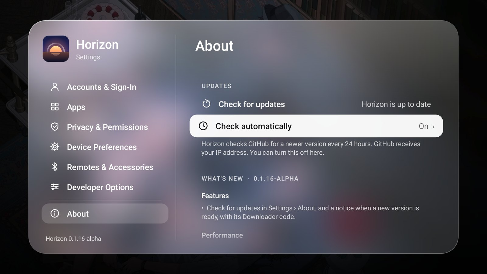
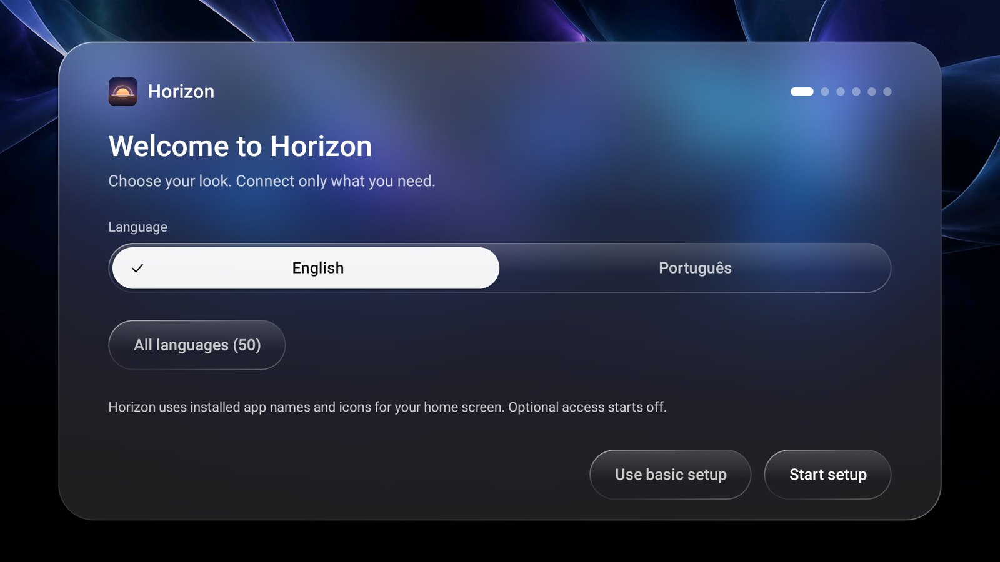
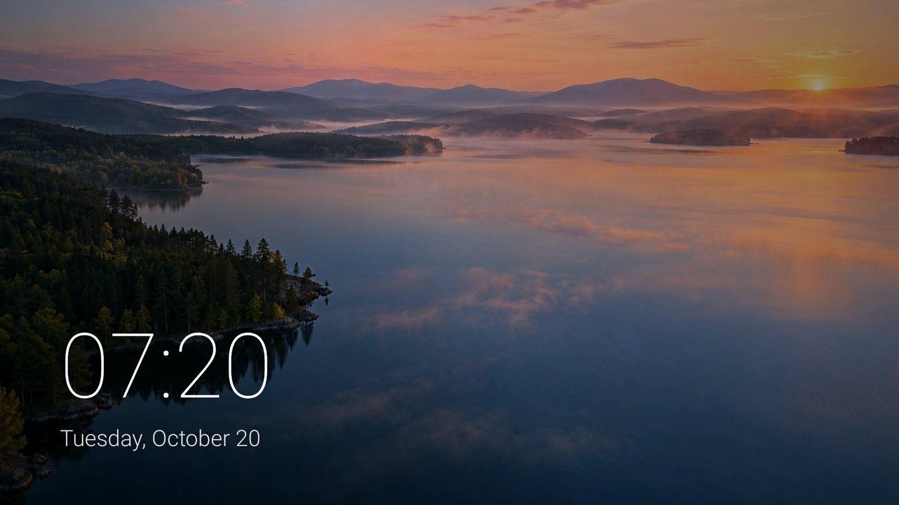

# Horizon TV

**PT** · Um ecrã inicial calmo e bonito para Android TV. Gratuito, feito em Maputo, para África.
**EN** · A calm, beautiful home screen for Android TV. Free, made in Maputo, for Africa.

| | |
|---|---|
|  |  |
|  |  |
|  |  |

## Instalar · Install

**Com o Downloader (recomendado) · With Downloader (recommended)**
1. Instale o **Downloader** (AFTVnews) a partir da Play Store da sua TV. · Install **Downloader** (AFTVnews) from your TV's Play Store.
2. Permita que o Downloader instale apps: *Definições › Privacidade/Segurança › Apps desconhecidas*. · Allow Downloader to install apps: *Settings › Privacy/Security › Unknown sources*.
3. No Downloader, introduza o código **5434541** e prima *Go*. · In Downloader, enter code **5434541** and press *Go*.
4. Instale e, quando a TV perguntar, escolha o Horizon como ecrã inicial. · Install, and when the TV asks, choose Horizon as the home screen.

**Ligação directa · Direct link:**
https://github.com/wdownload/HorizonTV-releases/releases/latest/download/HorizonTV.apk

O mesmo código instala sempre a versão mais recente, por cima da anterior, sem perder as definições.
The same code always installs the newest version over the previous one, keeping your settings.

## Outras línguas · Other languages

Español

Una pantalla de inicio tranquila y bonita para Android TV. Gratis, hecha en Maputo, para África.

**Instalar**

1. Instala Downloader (AFTVnews) desde la Play Store de tu TV.
2. Permite que Downloader instale apps (ajustes de Android › Orígenes desconocidos).
3. En Downloader, introduce el código **5434541** y pulsa Go.
4. Instala y, cuando la TV pregunte, elige Horizon como pantalla de inicio.

El mismo código instala siempre la versión más reciente sobre la anterior y conserva tus ajustes.

Enlace directo: https://github.com/wdownload/HorizonTV-releases/releases/latest/download/HorizonTV.apk

**Privacidad**

Todo lo opcional empieza desactivado, salvo la búsqueda de actualizaciones cada 24 horas, que puedes desactivar en Ajustes › Acerca de. Horizon nunca pide contraseñas de proveedores de TV.

Français

Un écran d’accueil calme et beau pour Android TV. Gratuit, fait à Maputo, pour l’Afrique.

**Installer**

1. Installez Downloader (AFTVnews) depuis le Play Store de votre TV.
2. Autorisez Downloader à installer des apps (paramètres Android › Sources inconnues).
3. Dans Downloader, saisissez le code **5434541** et appuyez sur Go.
4. Installez puis, quand la TV le demande, choisissez Horizon comme écran d’accueil.

Le même code installe toujours la dernière version par-dessus la précédente, en conservant vos réglages.

Lien direct: https://github.com/wdownload/HorizonTV-releases/releases/latest/download/HorizonTV.apk

**Confidentialité**

Tout ce qui est facultatif est désactivé au départ, sauf la recherche de mises à jour toutes les 24 heures, que vous pouvez désactiver dans Paramètres › À propos. Horizon ne demande jamais les mots de passe des fournisseurs TV.

العربية

شاشة رئيسية هادئة وجميلة لأجهزة Android TV. مجانية، صُنعت في مابوتو، لأفريقيا.

**التثبيت**

1. ثبّت Downloader (AFTVnews) من متجر Play على تلفزيونك.
2. اسمح لـ Downloader بتثبيت التطبيقات (إعدادات Android › مصادر غير معروفة).
3. في Downloader، أدخل الرمز **5434541** واضغط Go.
4. ثبّت التطبيق، وعندما يسأل التلفزيون اختر Horizon شاشةً رئيسية.

يثبّت الرمز نفسه دائمًا أحدث إصدار فوق الإصدار السابق مع الاحتفاظ بإعداداتك.

رابط مباشر: https://github.com/wdownload/HorizonTV-releases/releases/latest/download/HorizonTV.apk

**الخصوصية**

كل ما هو اختياري يبدأ متوقفًا، باستثناء البحث عن التحديثات كل 24 ساعة، ويمكنك إيقافه من الإعدادات › حول. لا يطلب Horizon أبدًا كلمات مرور مزوّدي التلفزيون.

简体中文

一款安静而美观的 Android TV 主屏幕。免费，诞生于马普托，为非洲而做。

**安装**

1. 从电视的 Play 商店安装 Downloader（AFTVnews）。
2. 允许 Downloader 安装应用（Android 设置 › 未知来源）。
3. 在 Downloader 中输入代码 **5434541**，然后按 Go。
4. 安装后，当电视询问时，选择 Horizon 作为主屏幕。

同一个代码始终会在旧版本之上安装最新版本，并保留你的设置。

直接链接: https://github.com/wdownload/HorizonTV-releases/releases/latest/download/HorizonTV.apk

**隐私**

所有可选功能默认关闭，只有每 24 小时检查一次更新例外，你可以在 设置 › 关于 中关闭。Horizon 从不索要电视服务商的密码。

繁體中文

一款安靜而美觀的 Android TV 主畫面。免費，誕生於馬普托，為非洲而做。

**安裝**

1. 從電視的 Play 商店安裝 Downloader（AFTVnews）。
2. 允許 Downloader 安裝應用程式（Android 設定 › 不明來源）。
3. 在 Downloader 中輸入代碼 **5434541**，然後按 Go。
4. 安裝後，當電視詢問時，選擇 Horizon 作為主畫面。

同一個代碼一律會在舊版本上安裝最新版本，並保留你的設定。

直接連結: https://github.com/wdownload/HorizonTV-releases/releases/latest/download/HorizonTV.apk

**隱私權**

所有選用功能預設關閉，只有每 24 小時檢查一次更新例外，你可以在 設定 › 關於 中關閉。Horizon 從不索取電視業者的密碼。

हिन्दी

Android TV के लिए एक शांत और सुंदर होम स्क्रीन। मुफ़्त, मापुटो में बनी, अफ़्रीका के लिए।

**इंस्टॉल करें**

1. अपने टीवी के Play Store से Downloader (AFTVnews) इंस्टॉल करें।
2. Downloader को ऐप इंस्टॉल करने की अनुमति दें (Android सेटिंग्स › अज्ञात स्रोत)।
3. Downloader में कोड **5434541** डालें और Go दबाएँ।
4. इंस्टॉल करें, और टीवी पूछे तो Horizon को होम स्क्रीन चुनें।

वही कोड हमेशा पिछले संस्करण के ऊपर नया संस्करण इंस्टॉल करता है और आपकी सेटिंग्स बनी रहती हैं।

सीधा लिंक: https://github.com/wdownload/HorizonTV-releases/releases/latest/download/HorizonTV.apk

**निजता**

सब कुछ वैकल्पिक शुरू में बंद रहता है, सिवाय हर 24 घंटे में अपडेट जाँच के, जिसे आप सेटिंग्स › जानकारी में बंद कर सकते हैं। Horizon कभी भी टीवी प्रदाता के पासवर्ड नहीं माँगता।

বাংলা

Android TV-র জন্য শান্ত ও সুন্দর একটি হোম স্ক্রিন। বিনামূল্যে, মাপুতোতে তৈরি, আফ্রিকার জন্য।

**ইনস্টল**

1. আপনার টিভির Play Store থেকে Downloader (AFTVnews) ইনস্টল করুন।
2. Downloader-কে অ্যাপ ইনস্টল করার অনুমতি দিন (Android সেটিংস › অজানা উৎস)।
3. Downloader-এ কোড **5434541** লিখে Go চাপুন।
4. ইনস্টল করুন, আর টিভি জিজ্ঞেস করলে Horizon-কে হোম স্ক্রিন হিসেবে বেছে নিন।

একই কোড সবসময় আগের সংস্করণের উপর সর্বশেষ সংস্করণ ইনস্টল করে, আপনার সেটিংস রেখে।

সরাসরি লিংক: https://github.com/wdownload/HorizonTV-releases/releases/latest/download/HorizonTV.apk

**গোপনীয়তা**

ঐচ্ছিক সবকিছু শুরুতে বন্ধ থাকে, শুধু প্রতি ২৪ ঘণ্টায় আপডেট খোঁজা ছাড়া, যা আপনি সেটিংস › সম্পর্কে-এ বন্ধ করতে পারেন। Horizon কখনও টিভি প্রোভাইডারের পাসওয়ার্ড চায় না।

Русский

Спокойный и красивый главный экран для Android TV. Бесплатно, сделано в Мапуту, для Африки.

**Установка**

1. Установите Downloader (AFTVnews) из Play Маркета на телевизоре.
2. Разрешите Downloader устанавливать приложения (настройки Android › Неизвестные источники).
3. В Downloader введите код **5434541** и нажмите Go.
4. Установите и, когда телевизор спросит, выберите Horizon главным экраном.

Тот же код всегда устанавливает новейшую версию поверх предыдущей и сохраняет ваши настройки.

Прямая ссылка: https://github.com/wdownload/HorizonTV-releases/releases/latest/download/HorizonTV.apk

**Конфиденциальность**

Всё необязательное изначально выключено, кроме проверки обновлений каждые 24 часа, которую можно выключить в разделе Настройки › О приложении. Horizon никогда не запрашивает пароли ТВ-провайдеров.

اردو

Android TV کے لیے پُرسکون اور خوبصورت ہوم اسکرین۔ مفت، ماپوتو میں بنی، افریقہ کے لیے۔

**انسٹال کریں**

1. اپنے ٹی وی کے Play Store سے Downloader (AFTVnews) انسٹال کریں۔
2. Downloader کو ایپس انسٹال کرنے کی اجازت دیں (Android ترتیبات › نامعلوم ذرائع)۔
3. Downloader میں کوڈ **5434541** درج کریں اور Go دبائیں۔
4. انسٹال کریں، اور جب ٹی وی پوچھے تو Horizon کو ہوم اسکرین منتخب کریں۔

وہی کوڈ ہمیشہ پچھلے ورژن پر تازہ ترین ورژن انسٹال کرتا ہے اور آپ کی ترتیبات برقرار رکھتا ہے۔

براہ راست لنک: https://github.com/wdownload/HorizonTV-releases/releases/latest/download/HorizonTV.apk

**رازداری**

ہر اختیاری چیز شروع میں بند ہوتی ہے، سوائے ہر 24 گھنٹے بعد اپ ڈیٹ کی جانچ کے، جسے آپ ترتیبات › تعارف میں بند کر سکتے ہیں۔ Horizon کبھی بھی ٹی وی فراہم کنندہ کے پاس ورڈ نہیں مانگتا۔

Bahasa Indonesia

Layar utama yang tenang dan indah untuk Android TV. Gratis, dibuat di Maputo, untuk Afrika.

**Pasang**

1. Pasang Downloader (AFTVnews) dari Play Store TV Anda.
2. Izinkan Downloader memasang aplikasi (setelan Android › Sumber tidak dikenal).
3. Di Downloader, masukkan kode **5434541** lalu tekan Go.
4. Pasang, dan saat TV bertanya, pilih Horizon sebagai layar utama.

Kode yang sama selalu memasang versi terbaru di atas versi sebelumnya dan pengaturan Anda tetap ada.

Tautan langsung: https://github.com/wdownload/HorizonTV-releases/releases/latest/download/HorizonTV.apk

**Privasi**

Semua yang opsional awalnya mati, kecuali pemeriksaan pembaruan setiap 24 jam, yang bisa Anda matikan di Pengaturan › Tentang. Horizon tidak pernah meminta kata sandi penyedia TV.

Deutsch

Ein ruhiger, schöner Startbildschirm für Android TV. Kostenlos, gemacht in Maputo, für Afrika.

**Installieren**

1. Installieren Sie Downloader (AFTVnews) aus dem Play Store Ihres Fernsehers.
2. Erlauben Sie Downloader, Apps zu installieren (Android-Einstellungen › Unbekannte Quellen).
3. Geben Sie in Downloader den Code **5434541** ein und drücken Sie Go.
4. Installieren und, wenn der Fernseher fragt, Horizon als Startbildschirm wählen.

Derselbe Code installiert immer die neueste Version über die vorherige und behält Ihre Einstellungen.

Direkter Link: https://github.com/wdownload/HorizonTV-releases/releases/latest/download/HorizonTV.apk

**Datenschutz**

Alles Optionale ist anfangs aus, außer der Update-Suche alle 24 Stunden, die Sie unter Einstellungen › Info ausschalten können. Horizon fragt nie nach Passwörtern von TV-Anbietern.

日本語

Android TV のための、落ち着いた美しいホーム画面。無料、マプトで作られ、アフリカのために。

**インストール**

1. テレビの Play ストアから Downloader（AFTVnews）をインストールします。
2. Downloader にアプリのインストールを許可します（Android の設定 › 提供元不明のアプリ）。
3. Downloader でコード **5434541** を入力し、Go を押します。
4. インストールし、テレビに聞かれたら Horizon をホーム画面に選びます。

同じコードで常に最新版が以前のバージョンに上書きでインストールされ、設定は保持されます。

直接リンク: https://github.com/wdownload/HorizonTV-releases/releases/latest/download/HorizonTV.apk

**プライバシー**

オプションはすべて最初はオフです。ただし 24 時間ごとのアップデート確認は例外で、設定 › 情報 でオフにできます。Horizon がテレビ事業者のパスワードを求めることはありません。

मराठी

Android TV साठी शांत आणि सुंदर होम स्क्रीन. मोफत, मापुटोमध्ये बनवलेली, आफ्रिकेसाठी.

**इन्स्टॉल करा**

1. तुमच्या टीव्हीच्या Play Store वरून Downloader (AFTVnews) इन्स्टॉल करा.
2. Downloader ला ॲप इन्स्टॉल करण्याची परवानगी द्या (Android सेटिंग्ज › अज्ञात स्रोत).
3. Downloader मध्ये कोड **5434541** टाका आणि Go दाबा.
4. इन्स्टॉल करा, आणि टीव्ही विचारेल तेव्हा Horizon ला होम स्क्रीन म्हणून निवडा.

तोच कोड नेहमी आधीच्या आवृत्तीवर नवीन आवृत्ती इन्स्टॉल करतो आणि तुमच्या सेटिंग्ज राहतात.

थेट लिंक: https://github.com/wdownload/HorizonTV-releases/releases/latest/download/HorizonTV.apk

**गोपनीयता**

सर्व पर्यायी गोष्टी सुरुवातीला बंद असतात, दर 24 तासांनी होणारी अपडेट तपासणी सोडून; ती तुम्ही सेटिंग्ज › माहिती मध्ये बंद करू शकता. Horizon कधीही टीव्ही प्रदात्याचे पासवर्ड मागत नाही.

తెలుగు

Android TV కోసం ప్రశాంతమైన, అందమైన హోమ్ స్క్రీన్. ఉచితం, మపుటోలో తయారైంది, ఆఫ్రికా కోసం.

**ఇన్‌స్టాల్ చేయండి**

1. మీ టీవీ Play Store నుండి Downloader (AFTVnews) ఇన్‌స్టాల్ చేయండి.
2. యాప్‌లు ఇన్‌స్టాల్ చేయడానికి Downloader‌ను అనుమతించండి (Android సెట్టింగ్‌లు › తెలియని మూలాలు).
3. Downloader లో కోడ్ **5434541** నమోదు చేసి Go నొక్కండి.
4. ఇన్‌స్టాల్ చేసి, టీవీ అడిగినప్పుడు Horizon ను హోమ్ స్క్రీన్‌గా ఎంచుకోండి.

అదే కోడ్ ఎల్లప్పుడూ మునుపటి వెర్షన్‌పై తాజా వెర్షన్‌ను ఇన్‌స్టాల్ చేసి, మీ సెట్టింగ్‌లను ఉంచుతుంది.

నేరుగా లింక్: https://github.com/wdownload/HorizonTV-releases/releases/latest/download/HorizonTV.apk

**గోప్యత**

ఐచ్ఛికమైనవన్నీ మొదట ఆఫ్‌లో ఉంటాయి, ప్రతి 24 గంటల అప్‌డేట్ తనిఖీ తప్ప; దాన్ని సెట్టింగ్‌లు › పరిచయం లో ఆఫ్ చేయవచ్చు. Horizon ఎప్పుడూ టీవీ ప్రొవైడర్ పాస్‌వర్డ్‌లు అడగదు.

Türkçe

Android TV için sakin ve güzel bir ana ekran. Ücretsiz, Maputo'da yapıldı, Afrika için.

**Yükle**

1. Downloader'ı (AFTVnews) TV'nizin Play Store'undan yükleyin.
2. Downloader'ın uygulama yüklemesine izin verin (Android ayarları › Bilinmeyen kaynaklar).
3. Downloader'da **5434541** kodunu girin ve Go'ya basın.
4. Yükleyin ve TV sorduğunda ana ekran olarak Horizon'u seçin.

Aynı kod her zaman en yeni sürümü öncekinin üzerine yükler ve ayarlarınızı korur.

Doğrudan bağlantı: https://github.com/wdownload/HorizonTV-releases/releases/latest/download/HorizonTV.apk

**Gizlilik**

İsteğe bağlı her şey başta kapalıdır; yalnızca 24 saatte bir yapılan güncelleme denetimi açıktır ve bunu Ayarlar › Hakkında bölümünden kapatabilirsiniz. Horizon asla TV sağlayıcı parolası istemez.

தமிழ்

Android TV-க்கான அமைதியான, அழகான முகப்புத் திரை. இலவசம், மபூட்டோவில் உருவானது, ஆப்பிரிக்காவுக்காக.

**நிறுவு**

1. உங்கள் டிவியின் Play Store-இலிருந்து Downloader (AFTVnews) ஐ நிறுவுங்கள்.
2. ஆப்களை நிறுவ Downloader-க்கு அனுமதி கொடுங்கள் (Android அமைப்புகள் › அறியப்படாத மூலங்கள்).
3. Downloader-இல் குறியீடு **5434541** ஐ உள்ளிட்டு Go அழுத்துங்கள்.
4. நிறுவி, டிவி கேட்கும்போது Horizon-ஐ முகப்புத் திரையாகத் தேர்ந்தெடுங்கள்.

அதே குறியீடு எப்போதும் முந்தைய பதிப்பின் மேல் புதிய பதிப்பை நிறுவி, உங்கள் அமைப்புகளைத் தக்கவைக்கிறது.

நேரடி இணைப்பு: https://github.com/wdownload/HorizonTV-releases/releases/latest/download/HorizonTV.apk

**தனியுரிமை**

விருப்பத்தேர்வுகள் அனைத்தும் தொடக்கத்தில் அணைக்கப்பட்டிருக்கும், 24 மணி நேரத்துக்கு ஒருமுறை புதுப்பிப்புச் சரிபார்ப்பு தவிர; அதை அமைப்புகள் › அறிமுகம்-இல் அணைக்கலாம். Horizon ஒருபோதும் டிவி வழங்குநர் கடவுச்சொல்லைக் கேட்காது.

Tiếng Việt

Màn hình chính yên tĩnh và đẹp cho Android TV. Miễn phí, làm tại Maputo, dành cho châu Phi.

**Cài đặt**

1. Cài Downloader (AFTVnews) từ Cửa hàng Play trên TV.
2. Cho phép Downloader cài ứng dụng (cài đặt Android › Nguồn không xác định).
3. Trong Downloader, nhập mã **5434541** rồi nhấn Go.
4. Cài đặt, và khi TV hỏi, chọn Horizon làm màn hình chính.

Cùng một mã luôn cài phiên bản mới nhất đè lên phiên bản trước và giữ nguyên cài đặt của bạn.

Liên kết trực tiếp: https://github.com/wdownload/HorizonTV-releases/releases/latest/download/HorizonTV.apk

**Quyền riêng tư**

Mọi tính năng tùy chọn đều tắt lúc đầu, trừ việc kiểm tra cập nhật mỗi 24 giờ, bạn có thể tắt trong Cài đặt › Giới thiệu. Horizon không bao giờ hỏi mật khẩu của nhà cung cấp TV.

Filipino

Isang tahimik at magandang home screen para sa Android TV. Libre, gawa sa Maputo, para sa Africa.

**I-install**

1. I-install ang Downloader (AFTVnews) mula sa Play Store ng iyong TV.
2. Payagan ang Downloader na mag-install ng mga app (mga setting ng Android › Hindi kilalang source).
3. Sa Downloader, ilagay ang code na **5434541** at pindutin ang Go.
4. I-install, at kapag nagtanong ang TV, piliin ang Horizon bilang home screen.

Laging ini-install ng parehong code ang pinakabagong bersyon sa ibabaw ng dati, at nananatili ang iyong mga setting.

Direktang link: https://github.com/wdownload/HorizonTV-releases/releases/latest/download/HorizonTV.apk

**Privacy**

Naka-off sa simula ang lahat ng opsyonal, maliban sa pagtingin ng update tuwing 24 na oras, na maaari mong i-off sa Mga Setting › Tungkol dito. Hindi kailanman humihingi ang Horizon ng password ng TV provider.

한국어

Android TV를 위한 차분하고 아름다운 홈 화면. 무료, 마푸투에서 만들어진 아프리카를 위한 앱.

**설치**

1. TV의 Play 스토어에서 Downloader(AFTVnews)를 설치하세요.
2. Downloader가 앱을 설치하도록 허용하세요(Android 설정 › 알 수 없는 출처).
3. Downloader에서 코드 **5434541**를 입력하고 Go를 누르세요.
4. 설치한 뒤 TV가 물으면 Horizon을 홈 화면으로 선택하세요.

같은 코드로 항상 최신 버전이 이전 버전 위에 설치되며 설정이 유지됩니다.

직접 링크: https://github.com/wdownload/HorizonTV-releases/releases/latest/download/HorizonTV.apk

**개인정보**

선택 기능은 모두 처음에 꺼져 있습니다. 단, 24시간마다 하는 업데이트 확인은 예외이며 설정 › 정보에서 끌 수 있습니다. Horizon은 TV 서비스 제공업체의 비밀번호를 절대 요구하지 않습니다.

فارسی

یک صفحه اصلی آرام و زیبا برای Android TV. رایگان، ساخته‌شده در ماپوتو، برای آفریقا.

**نصب**

1. Downloader (AFTVnews) را از Play Store تلویزیون خود نصب کنید.
2. به Downloader اجازه نصب برنامه بدهید (تنظیمات Android › منابع ناشناس).
3. در Downloader، کد **5434541** را وارد کنید و Go را بزنید.
4. نصب کنید و وقتی تلویزیون پرسید، Horizon را به‌عنوان صفحه اصلی انتخاب کنید.

همین کد همیشه جدیدترین نسخه را روی نسخه قبلی نصب می‌کند و تنظیمات شما حفظ می‌شود.

پیوند مستقیم: https://github.com/wdownload/HorizonTV-releases/releases/latest/download/HorizonTV.apk

**حریم خصوصی**

هر چیز اختیاری در آغاز خاموش است، به‌جز بررسی به‌روزرسانی هر ۲۴ ساعت که می‌توانید در تنظیمات › درباره خاموشش کنید. Horizon هرگز گذرواژه ارائه‌دهندگان تلویزیون را نمی‌خواهد.

Hausa

Allon gida mai natsuwa da kyau don Android TV. Kyauta, an yi shi a Maputo, don Afirka.

**Girka**

1. Girka Downloader (AFTVnews) daga Play Store na talabijin ɗinku.
2. Bari Downloader ya girka manhajoji (saitunan Android › Majiyoyin da ba a sani ba).
3. A Downloader, shigar da lambar **5434541** sannan danna Go.
4. Girka, kuma idan talabijin ta tambaya, zaɓi Horizon a matsayin allon gida.

Lambar ɗaya koyaushe tana girka sabon siga a kan na baya, tana adana saitunanku.

Hanyar kai tsaye: https://github.com/wdownload/HorizonTV-releases/releases/latest/download/HorizonTV.apk

**Sirri**

Duk abin da ba dole ba yana farawa a kashe, sai dai duba sabuntawa kowace awa 24, wanda za ku iya kashewa a Saituna › Game da. Horizon ba ya taɓa neman kalmomin sirri na masu samar da TV.

Kiswahili

Skrini ya nyumbani tulivu na nzuri kwa Android TV. Bure, imetengenezwa Maputo, kwa ajili ya Afrika.

**Sakinisha**

1. Sakinisha Downloader (AFTVnews) kutoka Play Store ya TV yako.
2. Ruhusu Downloader isakinishe programu (mipangilio ya Android › Vyanzo visivyojulikana).
3. Katika Downloader, weka msimbo **5434541** na ubonyeze Go.
4. Sakinisha, na TV ikiuliza, chagua Horizon kuwa skrini ya nyumbani.

Msimbo uleule husakinisha toleo jipya zaidi juu ya lile la awali kila mara, ukihifadhi mipangilio yako.

Kiungo cha moja kwa moja: https://github.com/wdownload/HorizonTV-releases/releases/latest/download/HorizonTV.apk

**Faragha**

Kila kitu cha hiari huanza kikiwa kimezimwa, isipokuwa ukaguzi wa masasisho kila saa 24, ambao unaweza kuuzima katika Mipangilio › Kuhusu. Horizon kamwe haiombi nenosiri za watoa huduma wa TV.

Basa Jawa

Layar ngarep sing tenang lan apik kanggo Android TV. Gratis, digawe ing Maputo, kanggo Afrika.

**Pasang**

1. Pasang Downloader (AFTVnews) saka Play Store TV sampeyan.
2. Idinake Downloader masang aplikasi (setelan Android › Sumber sing ora dikenal).
3. Ing Downloader, lebokna kode **5434541** banjur pencet Go.
4. Pasang, lan nalika TV takon, pilih Horizon minangka layar ngarep.

Kode sing padha tansah masang versi paling anyar ing ndhuwur sing sadurunge, setelan sampeyan tetep.

Link langsung: https://github.com/wdownload/HorizonTV-releases/releases/latest/download/HorizonTV.apk

**Privasi**

Kabeh sing opsional wiwit mati, kajaba mriksa nganyari saben 24 jam, sing bisa sampeyan pateni ing Setelan › Babagan. Horizon ora tau njaluk sandhi panyedhiya TV.

Italiano

Una schermata Home calma e bella per Android TV. Gratuita, fatta a Maputo, per l’Africa.

**Installa**

1. Installa Downloader (AFTVnews) dal Play Store della tua TV.
2. Consenti a Downloader di installare app (impostazioni Android › Origini sconosciute).
3. In Downloader, inserisci il codice **5434541** e premi Go.
4. Installa e, quando la TV lo chiede, scegli Horizon come schermata Home.

Lo stesso codice installa sempre la versione più recente sopra quella precedente, mantenendo le tue impostazioni.

Link diretto: https://github.com/wdownload/HorizonTV-releases/releases/latest/download/HorizonTV.apk

**Privacy**

Tutto ciò che è facoltativo parte disattivato, tranne la ricerca di aggiornamenti ogni 24 ore, che puoi disattivare in Impostazioni › Info. Horizon non chiede mai le password dei fornitori TV.

ਪੰਜਾਬੀ

Android TV ਲਈ ਸ਼ਾਂਤ ਅਤੇ ਸੁੰਦਰ ਹੋਮ ਸਕ੍ਰੀਨ। ਮੁਫ਼ਤ, ਮਾਪੁਟੋ ਵਿੱਚ ਬਣੀ, ਅਫ਼ਰੀਕਾ ਲਈ।

**ਇੰਸਟਾਲ ਕਰੋ**

1. ਆਪਣੇ ਟੀਵੀ ਦੇ Play Store ਤੋਂ Downloader (AFTVnews) ਇੰਸਟਾਲ ਕਰੋ।
2. Downloader ਨੂੰ ਐਪਾਂ ਇੰਸਟਾਲ ਕਰਨ ਦੀ ਇਜਾਜ਼ਤ ਦਿਓ (Android ਸੈਟਿੰਗਾਂ › ਅਣਜਾਣ ਸਰੋਤ)।
3. Downloader ਵਿੱਚ ਕੋਡ **5434541** ਦਾਖਲ ਕਰੋ ਅਤੇ Go ਦਬਾਓ।
4. ਇੰਸਟਾਲ ਕਰੋ, ਅਤੇ ਟੀਵੀ ਪੁੱਛੇ ਤਾਂ Horizon ਨੂੰ ਹੋਮ ਸਕ੍ਰੀਨ ਵਜੋਂ ਚੁਣੋ।

ਉਹੀ ਕੋਡ ਹਮੇਸ਼ਾ ਪਿਛਲੇ ਸੰਸਕਰਣ ਉੱਤੇ ਨਵਾਂ ਸੰਸਕਰਣ ਇੰਸਟਾਲ ਕਰਦਾ ਹੈ ਅਤੇ ਤੁਹਾਡੀਆਂ ਸੈਟਿੰਗਾਂ ਰੱਖਦਾ ਹੈ।

ਸਿੱਧਾ ਲਿੰਕ: https://github.com/wdownload/HorizonTV-releases/releases/latest/download/HorizonTV.apk

**ਪਰਦੇਦਾਰੀ**

ਸਾਰਾ ਕੁਝ ਵਿਕਲਪਿਕ ਸ਼ੁਰੂ ਵਿੱਚ ਬੰਦ ਹੁੰਦਾ ਹੈ, ਹਰ 24 ਘੰਟਿਆਂ ਦੀ ਅੱਪਡੇਟ ਜਾਂਚ ਤੋਂ ਸਿਵਾ, ਜਿਸ ਨੂੰ ਤੁਸੀਂ ਸੈਟਿੰਗਾਂ › ਬਾਰੇ ਵਿੱਚ ਬੰਦ ਕਰ ਸਕਦੇ ਹੋ। Horizon ਕਦੇ ਵੀ ਟੀਵੀ ਪ੍ਰਦਾਤਾ ਦੇ ਪਾਸਵਰਡ ਨਹੀਂ ਮੰਗਦਾ।

ಕನ್ನಡ

Android TV ಗಾಗಿ ಶಾಂತ ಮತ್ತು ಸುಂದರ ಹೋಮ್ ಸ್ಕ್ರೀನ್. ಉಚಿತ, ಮಾಪುಟೋದಲ್ಲಿ ತಯಾರಾದದ್ದು, ಆಫ್ರಿಕಾಗಾಗಿ.

**ಸ್ಥಾಪಿಸಿ**

1. ನಿಮ್ಮ ಟಿವಿಯ Play Store ನಿಂದ Downloader (AFTVnews) ಸ್ಥಾಪಿಸಿ.
2. Downloader ಗೆ ಆ್ಯಪ್‌ಗಳನ್ನು ಸ್ಥಾಪಿಸಲು ಅನುಮತಿಸಿ (Android ಸೆಟ್ಟಿಂಗ್‌ಗಳು › ಅಪರಿಚಿತ ಮೂಲಗಳು).
3. Downloader ನಲ್ಲಿ ಕೋಡ್ **5434541** ನಮೂದಿಸಿ Go ಒತ್ತಿರಿ.
4. ಸ್ಥಾಪಿಸಿ, ಟಿವಿ ಕೇಳಿದಾಗ Horizon ಅನ್ನು ಹೋಮ್ ಸ್ಕ್ರೀನ್ ಆಗಿ ಆರಿಸಿ.

ಅದೇ ಕೋಡ್ ಯಾವಾಗಲೂ ಹಿಂದಿನ ಆವೃತ್ತಿಯ ಮೇಲೆ ಹೊಸ ಆವೃತ್ತಿಯನ್ನು ಸ್ಥಾಪಿಸುತ್ತದೆ ಮತ್ತು ನಿಮ್ಮ ಸೆಟ್ಟಿಂಗ್‌ಗಳನ್ನು ಉಳಿಸುತ್ತದೆ.

ನೇರ ಲಿಂಕ್: https://github.com/wdownload/HorizonTV-releases/releases/latest/download/HorizonTV.apk

**ಗೌಪ್ಯತೆ**

ಐಚ್ಛಿಕವಾದ ಎಲ್ಲವೂ ಮೊದಲು ಆಫ್ ಆಗಿರುತ್ತವೆ, ಪ್ರತಿ 24 ಗಂಟೆಗಳ ಅಪ್‌ಡೇಟ್ ಪರಿಶೀಲನೆ ಹೊರತುಪಡಿಸಿ; ಅದನ್ನು ಸೆಟ್ಟಿಂಗ್‌ಗಳು › ಕುರಿತು ನಲ್ಲಿ ಆಫ್ ಮಾಡಬಹುದು. Horizon ಎಂದಿಗೂ ಟಿವಿ ಸೇವಾದಾರರ ಪಾಸ್‌ವರ್ಡ್ ಕೇಳುವುದಿಲ್ಲ.

ગુજરાતી

Android TV માટે શાંત અને સુંદર હોમ સ્ક્રીન. મફત, માપુટોમાં બનાવેલી, આફ્રિકા માટે.

**ઇન્સ્ટોલ**

1. તમારા ટીવીના Play Store માંથી Downloader (AFTVnews) ઇન્સ્ટોલ કરો.
2. Downloader ને ઍપ ઇન્સ્ટોલ કરવાની મંજૂરી આપો (Android સેટિંગ્સ › અજાણ્યા સ્ત્રોતો).
3. Downloader માં કોડ **5434541** દાખલ કરો અને Go દબાવો.
4. ઇન્સ્ટોલ કરો, અને ટીવી પૂછે ત્યારે Horizon ને હોમ સ્ક્રીન તરીકે પસંદ કરો.

એ જ કોડ હંમેશા અગાઉના સંસ્કરણ પર નવું સંસ્કરણ ઇન્સ્ટોલ કરે છે અને તમારી સેટિંગ્સ જાળવે છે.

સીધી લિંક: https://github.com/wdownload/HorizonTV-releases/releases/latest/download/HorizonTV.apk

**ગોપનીયતા**

બધું વૈકલ્પિક શરૂઆતમાં બંધ હોય છે, દર 24 કલાકે અપડેટ તપાસ સિવાય, જે તમે સેટિંગ્સ › વિશે માં બંધ કરી શકો છો. Horizon ક્યારેય ટીવી પ્રદાતાના પાસવર્ડ માગતું નથી.

ไทย

หน้าจอหลักที่สงบและสวยงามสำหรับ Android TV ฟรี สร้างที่มาปูโต เพื่อแอฟริกา

**ติดตั้ง**

1. ติดตั้ง Downloader (AFTVnews) จาก Play Store ของทีวี
2. อนุญาตให้ Downloader ติดตั้งแอป (การตั้งค่า Android › แหล่งที่มาที่ไม่รู้จัก)
3. ใน Downloader ให้ป้อนรหัส **5434541** แล้วกด Go
4. ติดตั้ง และเมื่อทีวีถาม ให้เลือก Horizon เป็นหน้าจอหลัก

รหัสเดิมจะติดตั้งเวอร์ชันล่าสุดทับเวอร์ชันก่อนหน้าเสมอ และคงการตั้งค่าของคุณไว้

ลิงก์โดยตรง: https://github.com/wdownload/HorizonTV-releases/releases/latest/download/HorizonTV.apk

**ความเป็นส่วนตัว**

ทุกอย่างที่เป็นตัวเลือกจะปิดอยู่ตอนเริ่ม ยกเว้นการตรวจหาอัปเดตทุก 24 ชั่วโมง ซึ่งปิดได้ที่ การตั้งค่า › เกี่ยวกับ Horizon ไม่เคยขอรหัสผ่านของผู้ให้บริการทีวี

አማርኛ

ለAndroid TV የተረጋጋ እና የሚያምር መነሻ ማያ። ነጻ፣ በማፑቶ የተሰራ፣ ለአፍሪካ።

**ጫን**

1. Downloader (AFTVnews)ን ከቲቪዎ Play Store ይጫኑ።
2. Downloader መተግበሪያዎችን እንዲጭን ይፍቀዱ (የAndroid ቅንብሮች › ያልታወቁ ምንጮች)።
3. በDownloader ውስጥ ኮድ **5434541** ያስገቡና Go ይጫኑ።
4. ይጫኑ፣ ቲቪው ሲጠይቅም Horizonን እንደ መነሻ ማያ ይምረጡ።

ያው ኮድ ሁልጊዜ አዲሱን ስሪት በቀድሞው ላይ ይጭናል፣ ቅንብሮችዎንም ይጠብቃል።

ቀጥተኛ አገናኝ: https://github.com/wdownload/HorizonTV-releases/releases/latest/download/HorizonTV.apk

**ግላዊነት**

አማራጭ የሆነ ሁሉ መጀመሪያ ጠፍቶ ይጀምራል፣ በየ24 ሰዓቱ ከሚደረገው የዝማኔ ፍለጋ በስተቀር፤ ይህን በቅንብሮች › ስለ ማጥፋት ይችላሉ። Horizon የቲቪ አቅራቢ የይለፍ ቃሎችን በጭራሽ አይጠይቅም።

Yorùbá

Ojú-ìbojú ilé tó parọ́rọ́, tó sì lẹ́wà fún Android TV. Ọ̀fẹ́, a ṣe é ní Maputo, fún Áfíríkà.

**Fi sórí ẹ̀rọ**

1. Fi Downloader (AFTVnews) sórí ẹ̀rọ láti Play Store TV rẹ.
2. Gba Downloader láàyè láti fi áàpù sórí ẹ̀rọ (ètò Android › Àwọn orísun tí a kò mọ̀).
3. Nínú Downloader, tẹ kóòdù **5434541** kí o sì tẹ Go.
4. Fi sórí ẹ̀rọ, nígbà tí TV bá béèrè, yan Horizon gẹ́gẹ́ bí ojú-ìbojú ilé.

Kóòdù kan náà máa ń fi ẹ̀yà tuntun jùlọ sórí ti tẹ́lẹ̀ nígbà gbogbo, ó sì ń pa ètò rẹ mọ́.

Ìjápọ̀ tààrà: https://github.com/wdownload/HorizonTV-releases/releases/latest/download/HorizonTV.apk

**Ìpamọ́**

Gbogbo ohun àṣàyàn máa ń bẹ̀rẹ̀ ní pípa, àfi àyẹ̀wò ìmúdójúìwọ̀n ní gbogbo wákàtí 24, tí o lè pa ní Ètò › Nípa. Horizon kì í béèrè ọ̀rọ̀ aṣínà olùpèsè TV rárá.

Polski

Spokojny, piękny ekran główny dla Android TV. Darmowy, stworzony w Maputo, dla Afryki.

**Instalacja**

1. Zainstaluj Downloader (AFTVnews) ze Sklepu Play w telewizorze.
2. Zezwól aplikacji Downloader na instalowanie aplikacji (ustawienia Androida › Nieznane źródła).
3. W aplikacji Downloader wpisz kod **5434541** i naciśnij Go.
4. Zainstaluj, a gdy telewizor zapyta, wybierz Horizon jako ekran główny.

Ten sam kod zawsze instaluje najnowszą wersję na poprzedniej, zachowując Twoje ustawienia.

Link bezpośredni: https://github.com/wdownload/HorizonTV-releases/releases/latest/download/HorizonTV.apk

**Prywatność**

Wszystko, co opcjonalne, jest na początku wyłączone, oprócz sprawdzania aktualizacji co 24 godziny, które możesz wyłączyć w Ustawienia › Informacje. Horizon nigdy nie prosi o hasła dostawców telewizji.

ଓଡ଼ିଆ

Android TV ପାଇଁ ଶାନ୍ତ ଓ ସୁନ୍ଦର ହୋମ ସ୍କ୍ରିନ। ମାଗଣା, ମାପୁଟୋରେ ତିଆରି, ଆଫ୍ରିକା ପାଇଁ।

**ଇନଷ୍ଟଲ୍ କରନ୍ତୁ**

1. ଆପଣଙ୍କ ଟିଭିର Play Store ରୁ Downloader (AFTVnews) ଇନଷ୍ଟଲ୍ କରନ୍ତୁ।
2. Downloader କୁ ଆପ୍ ଇନଷ୍ଟଲ୍ କରିବାକୁ ଅନୁମତି ଦିଅନ୍ତୁ (Android ସେଟିଂସ › ଅଜଣା ଉତ୍ସ)।
3. Downloader ରେ କୋଡ୍ **5434541** ଲେଖି Go ଦବାନ୍ତୁ।
4. ଇନଷ୍ଟଲ୍ କରନ୍ତୁ, ଟିଭି ପଚାରିଲେ Horizon କୁ ହୋମ ସ୍କ୍ରିନ ଭାବେ ବାଛନ୍ତୁ।

ସେହି କୋଡ୍ ସର୍ବଦା ପୂର୍ବ ସଂସ୍କରଣ ଉପରେ ନୂଆ ସଂସ୍କରଣ ଇନଷ୍ଟଲ୍ କରେ ଏବଂ ଆପଣଙ୍କ ସେଟିଂସ ରଖେ।

ସିଧା ଲିଙ୍କ: https://github.com/wdownload/HorizonTV-releases/releases/latest/download/HorizonTV.apk

**ଗୋପନୀୟତା**

ସମସ୍ତ ବିକଳ୍ପ ପ୍ରଥମେ ବନ୍ଦ ଥାଏ, ପ୍ରତି 24 ଘଣ୍ଟାର ଅପଡେଟ୍ ଯାଞ୍ଚ ଛଡ଼ା, ଯାହା ଆପଣ ସେଟିଂସ › ବିଷୟରେ ରେ ବନ୍ଦ କରିପାରିବେ। Horizon କେବେ ବି ଟିଭି ପ୍ରଦାତାର ପାସୱାର୍ଡ ମାଗେ ନାହିଁ।

മലയാളം

Android TV-ക്കായി ശാന്തവും മനോഹരവുമായ ഹോം സ്ക്രീൻ. സൗജന്യം, മാപ്പുട്ടോയിൽ നിർമ്മിച്ചത്, ആഫ്രിക്കയ്ക്കായി.

**ഇൻസ്റ്റാൾ ചെയ്യുക**

1. നിങ്ങളുടെ ടിവിയുടെ Play Store-ൽ നിന്ന് Downloader (AFTVnews) ഇൻസ്റ്റാൾ ചെയ്യുക.
2. ആപ്പുകൾ ഇൻസ്റ്റാൾ ചെയ്യാൻ Downloader-നെ അനുവദിക്കുക (Android ക്രമീകരണങ്ങൾ › അജ്ഞാത ഉറവിടങ്ങൾ).
3. Downloader-ൽ കോഡ് **5434541** നൽകി Go അമർത്തുക.
4. ഇൻസ്റ്റാൾ ചെയ്യുക, ടിവി ചോദിക്കുമ്പോൾ Horizon ഹോം സ്ക്രീനായി തിരഞ്ഞെടുക്കുക.

ഒരേ കോഡ് എപ്പോഴും മുൻ പതിപ്പിന് മുകളിൽ പുതിയ പതിപ്പ് ഇൻസ്റ്റാൾ ചെയ്യുന്നു, ക്രമീകരണങ്ങൾ നിലനിർത്തുന്നു.

നേരിട്ടുള്ള ലിങ്ക്: https://github.com/wdownload/HorizonTV-releases/releases/latest/download/HorizonTV.apk

**സ്വകാര്യത**

ഓപ്ഷണലായവയെല്ലാം തുടക്കത്തിൽ ഓഫാണ്, ഓരോ 24 മണിക്കൂറിലുമുള്ള അപ്‌ഡേറ്റ് പരിശോധന ഒഴികെ; അത് ക്രമീകരണങ്ങൾ › വിവരം-ൽ ഓഫാക്കാം. Horizon ഒരിക്കലും ടിവി ദാതാവിന്റെ പാസ്‌വേഡ് ചോദിക്കില്ല.

မြန်မာ

Android TV အတွက် တည်ငြိမ်လှပသော ပင်မမျက်နှာပြင်။ အခမဲ့၊ မာပူတိုတွင် ဖန်တီးထားပြီး အာဖရိကအတွက်။

**ထည့်သွင်းရန်**

1. သင့် TV ၏ Play Store မှ Downloader (AFTVnews) ကို ထည့်သွင်းပါ။
2. Downloader ကို အက်ပ်များ ထည့်သွင်းခွင့်ပြုပါ (Android ဆက်တင်များ › အမည်မသိ ရင်းမြစ်များ)။
3. Downloader တွင် ကုဒ် **5434541** ကို ထည့်ပြီး Go ကို နှိပ်ပါ။
4. ထည့်သွင်းပြီး TV က မေးသောအခါ Horizon ကို ပင်မမျက်နှာပြင်အဖြစ် ရွေးပါ။

တူညီသော ကုဒ်သည် ယခင်ဗားရှင်းပေါ်တွင် နောက်ဆုံးဗားရှင်းကို အမြဲထည့်သွင်းပြီး သင့်ဆက်တင်များကို ထိန်းထားသည်။

တိုက်ရိုက်လင့်ခ်: https://github.com/wdownload/HorizonTV-releases/releases/latest/download/HorizonTV.apk

**ကိုယ်ရေးလုံခြုံမှု**

ရွေးချယ်နိုင်သော အရာအားလုံး အစတွင် ပိတ်ထားပြီး ၂၄ နာရီတိုင်း အပ်ဒိတ်စစ်ခြင်းသာ ခြွင်းချက်ဖြစ်သည်၊ ၎င်းကို ဆက်တင်များ › အကြောင်း တွင် ပိတ်နိုင်သည်။ Horizon သည် TV ဝန်ဆောင်မှုပေးသူ စကားဝှက်ကို ဘယ်တော့မှ မတောင်းပါ။

Oʻzbekcha

Android TV uchun sokin va chiroyli bosh ekran. Bepul, Maputoda yaratilgan, Afrika uchun.

**O'rnatish**

1. Downloader (AFTVnews) ilovasini televizoringiz Play Store'idan o'rnating.
2. Downloader'ga ilovalar o'rnatishga ruxsat bering (Android sozlamalari › Noma'lum manbalar).
3. Downloader'da **5434541** kodini kiriting va Go tugmasini bosing.
4. O'rnating va televizor so'raganda Horizon'ni bosh ekran sifatida tanlang.

Xuddi shu kod har doim eng yangi versiyani oldingisining ustiga o'rnatadi va sozlamalaringizni saqlaydi.

To'g'ridan-to'g'ri havola: https://github.com/wdownload/HorizonTV-releases/releases/latest/download/HorizonTV.apk

**Maxfiylik**

Barcha ixtiyoriy funksiyalar boshida o'chirilgan, har 24 soatlik yangilanish tekshiruvidan tashqari; uni Sozlamalar › Ilova haqida bo'limida o'chirishingiz mumkin. Horizon hech qachon TV provayderi parollarini so'ramaydi.

Igbo

Ihuenyo ụlọ dị jụụ ma maa mma maka Android TV. N'efu, e mere ya na Maputo, maka Africa.

**Tinye**

1. Tinye Downloader (AFTVnews) site na Play Store nke TV gị.
2. Kwe ka Downloader tinye ngwa (ntọala Android › Isi mmalite amaghị ama).
3. Na Downloader, tinye koodu **5434541** ma pịa Go.
4. Tinye ya, ma mgbe TV jụrụ, họrọ Horizon dịka ihuenyo ụlọ.

Otu koodu ahụ na-etinye ụdị kachasị ọhụrụ n'elu nke gara aga mgbe niile, na-edebe ntọala gị.

Njikọ ozugbo: https://github.com/wdownload/HorizonTV-releases/releases/latest/download/HorizonTV.apk

**Nzuzo**

Ihe niile nhọrọ na-amalite na-agbanyụ, ewezuga nlele mmelite kwa awa 24, nke ị nwere ike gbanyụọ na Ntọala › Banyere. Horizon anaghị arịọ okwuntughe ndị na-enye TV.

Українська

Спокійний і гарний головний екран для Android TV. Безкоштовно, створено в Мапуту, для Африки.

**Встановлення**

1. Встановіть Downloader (AFTVnews) з Play Маркету на телевізорі.
2. Дозвольте Downloader встановлювати застосунки (налаштування Android › Невідомі джерела).
3. У Downloader введіть код **5434541** і натисніть Go.
4. Встановіть і, коли телевізор запитає, виберіть Horizon головним екраном.

Той самий код завжди встановлює найновішу версію поверх попередньої та зберігає ваші налаштування.

Пряме посилання: https://github.com/wdownload/HorizonTV-releases/releases/latest/download/HorizonTV.apk

**Конфіденційність**

Усе необов’язкове спочатку вимкнено, крім перевірки оновлень кожні 24 години, яку можна вимкнути в Налаштування › Про застосунок. Horizon ніколи не запитує паролі ТВ-провайдерів.

Română

Un ecran principal liniștit și frumos pentru Android TV. Gratuit, creat la Maputo, pentru Africa.

**Instalare**

1. Instalați Downloader (AFTVnews) din Magazinul Play al televizorului.
2. Permiteți aplicației Downloader să instaleze aplicații (setări Android › Surse necunoscute).
3. În Downloader, introduceți codul **5434541** și apăsați Go.
4. Instalați și, când televizorul întreabă, alegeți Horizon ca ecran principal.

Același cod instalează mereu cea mai nouă versiune peste cea anterioară, păstrându-vă setările.

Link direct: https://github.com/wdownload/HorizonTV-releases/releases/latest/download/HorizonTV.apk

**Confidențialitate**

Tot ce este opțional pornește dezactivat, cu excepția căutării actualizărilor la fiecare 24 de ore, pe care o puteți opri din Setări › Despre. Horizon nu cere niciodată parolele furnizorilor TV.

Nederlands

Een rustig, mooi startscherm voor Android TV. Gratis, gemaakt in Maputo, voor Afrika.

**Installeren**

1. Installeer Downloader (AFTVnews) via de Play Store van je tv.
2. Sta Downloader toe apps te installeren (Android-instellingen › Onbekende bronnen).
3. Voer in Downloader de code **5434541** in en druk op Go.
4. Installeer en kies Horizon als startscherm wanneer de tv erom vraagt.

Dezelfde code installeert altijd de nieuwste versie over de vorige heen en behoudt je instellingen.

Directe link: https://github.com/wdownload/HorizonTV-releases/releases/latest/download/HorizonTV.apk

**Privacy**

Alles wat optioneel is staat eerst uit, behalve het zoeken naar updates elke 24 uur, dat je kunt uitzetten in Instellingen › Over. Horizon vraagt nooit om wachtwoorden van tv-aanbieders.

Bahasa Melayu

Skrin utama yang tenang dan cantik untuk Android TV. Percuma, dibuat di Maputo, untuk Afrika.

**Pasang**

1. Pasang Downloader (AFTVnews) daripada Play Store TV anda.
2. Benarkan Downloader memasang apl (tetapan Android › Sumber tidak diketahui).
3. Dalam Downloader, masukkan kod **5434541** dan tekan Go.
4. Pasang, dan apabila TV bertanya, pilih Horizon sebagai skrin utama.

Kod yang sama sentiasa memasang versi terbaharu di atas versi sebelumnya dan tetapan anda kekal.

Pautan terus: https://github.com/wdownload/HorizonTV-releases/releases/latest/download/HorizonTV.apk

**Privasi**

Semua yang pilihan bermula dimatikan, kecuali semakan kemas kini setiap 24 jam, yang boleh anda matikan dalam Tetapan › Perihal. Horizon tidak pernah meminta kata laluan pembekal TV.

Azərbaycan

Android TV üçün sakit, gözəl ana ekran. Pulsuz, Maputoda hazırlanıb, Afrika üçün.

**Quraşdır**

1. Downloader (AFTVnews) tətbiqini televizorunuzun Play Store-dan quraşdırın.
2. Downloader-ə tətbiq quraşdırmağa icazə verin (Android parametrləri › Naməlum mənbələr).
3. Downloader-də **5434541** kodunu daxil edin və Go düyməsini basın.
4. Quraşdırın və televizor soruşduqda Horizon-u ana ekran kimi seçin.

Eyni kod həmişə ən yeni versiyanı əvvəlkinin üzərinə quraşdırır və parametrlərinizi saxlayır.

Birbaşa keçid: https://github.com/wdownload/HorizonTV-releases/releases/latest/download/HorizonTV.apk

**Məxfilik**

Bütün isteğe bağlı funksiyalar söndürülmüş başlayır, 24 saatdan bir yeniləmə axtarışı istisna olmaqla; onu Parametrləri › Haqqında bölməsində söndürə bilərsiniz. Horizon heç vaxt TV provayderlərinin parollarını istəmir.

नेपाली

Android TV का लागि शान्त र सुन्दर होम स्क्रिन। निःशुल्क, मापुटोमा बनाइएको, अफ्रिकाका लागि।

**स्थापना गर्नुहोस्**

1. आफ्नो टिभीको Play Store बाट Downloader (AFTVnews) स्थापना गर्नुहोस्।
2. Downloader लाई एप स्थापना गर्न अनुमति दिनुहोस् (Android सेटिङ › अज्ञात स्रोतहरू)।
3. Downloader मा कोड **5434541** हालेर Go थिच्नुहोस्।
4. स्थापना गर्नुहोस्, र टिभीले सोध्दा Horizon लाई होम स्क्रिनका रूपमा छान्नुहोस्।

उही कोडले सधैँ अघिल्लो संस्करणमाथि नयाँ संस्करण स्थापना गर्छ र तपाईंका सेटिङ राख्छ।

सीधा लिंक: https://github.com/wdownload/HorizonTV-releases/releases/latest/download/HorizonTV.apk

**गोपनीयता**

सबै वैकल्पिक कुरा सुरुमा बन्द हुन्छन्, हरेक 24 घण्टाको अपडेट जाँच बाहेक, जुन तपाईं सेटिङहरू › बारेमा मा बन्द गर्न सक्नुहुन्छ। Horizon ले कहिल्यै टिभी प्रदायकको पासवर्ड माग्दैन।

isiZulu

Isikrini sasekhaya esizolile nesihle se-Android TV. Mahhala, senziwe eMaputo, sise-Afrika.

**Faka**

1. Faka i-Downloader (AFTVnews) usuka ku-Play Store ye-TV yakho.
2. Vumela i-Downloader ukuthi ifake izinhlelo zokusebenza (izilungiselelo ze-Android › Imithombo engaziwa).
3. Ku-Downloader, faka ikhodi **5434541** bese ucindezela u-Go.
4. Faka, futhi lapho i-TV ibuza, khetha i-Horizon njengesikrini sasekhaya.

Ikhodi efanayo ihlala ifaka inguqulo yakamuva phezu kweyangaphambili, igcine izilungiselelo zakho.

Isixhumanisi esiqondile: https://github.com/wdownload/HorizonTV-releases/releases/latest/download/HorizonTV.apk

**Ubumfihlo**

Konke okungukuzikhethela kuqala kuvaliwe, ngaphandle kokuhlola izibuyekezo njalo emahoreni angu-24, ongakuvala ku-Izilungiselelo › Mayelana. I-Horizon ayilokothi icele amaphasiwedi abahlinzeki be-TV.

Ελληνικά

Μια ήρεμη, όμορφη αρχική οθόνη για Android TV. Δωρεάν, φτιαγμένη στο Μαπούτο, για την Αφρική.

**Εγκατάσταση**

1. Εγκαταστήστε το Downloader (AFTVnews) από το Play Store της τηλεόρασής σας.
2. Επιτρέψτε στο Downloader να εγκαθιστά εφαρμογές (ρυθμίσεις Android › Άγνωστες πηγές).
3. Στο Downloader, εισαγάγετε τον κωδικό **5434541** και πατήστε Go.
4. Εγκαταστήστε και, όταν ρωτήσει η τηλεόραση, επιλέξτε το Horizon ως αρχική οθόνη.

Ο ίδιος κωδικός εγκαθιστά πάντα την πιο πρόσφατη έκδοση πάνω από την προηγούμενη, κρατώντας τις ρυθμίσεις σας.

Άμεσος σύνδεσμος: https://github.com/wdownload/HorizonTV-releases/releases/latest/download/HorizonTV.apk

**Απόρρητο**

Ό,τι είναι προαιρετικό ξεκινά απενεργοποιημένο, εκτός από τον έλεγχο για ενημερώσεις κάθε 24 ώρες, που μπορείτε να απενεργοποιήσετε στις Ρυθμίσεις › Σχετικά. Το Horizon δεν ζητά ποτέ κωδικούς παρόχων TV.

Čeština

Klidná a krásná domovská obrazovka pro Android TV. Zdarma, vytvořená v Maputu, pro Afriku.

**Instalace**

1. Nainstalujte Downloader (AFTVnews) z Obchodu Play na televizi.
2. Povolte aplikaci Downloader instalovat aplikace (nastavení Androidu › Neznámé zdroje).
3. V aplikaci Downloader zadejte kód **5434541** a stiskněte Go.
4. Nainstalujte a až se televize zeptá, zvolte Horizon jako domovskou obrazovku.

Stejný kód vždy nainstaluje nejnovější verzi přes tu předchozí a zachová vaše nastavení.

Přímý odkaz: https://github.com/wdownload/HorizonTV-releases/releases/latest/download/HorizonTV.apk

**Soukromí**

Vše volitelné je zpočátku vypnuté kromě hledání aktualizací každých 24 hodin, které můžete vypnout v Nastavení › O aplikaci. Horizon nikdy nežádá hesla poskytovatelů TV.

Magyar

Nyugodt, szép kezdőképernyő Android TV-re. Ingyenes, Maputóban készült, Afrikának.

**Telepítés**

1. Telepítse a Downloadert (AFTVnews) a tévé Play Áruházából.
2. Engedélyezze, hogy a Downloader alkalmazásokat telepítsen (Android-beállítások › Ismeretlen források).
3. A Downloaderben írja be a(z) **5434541** kódot, és nyomja meg a Go gombot.
4. Telepítse, és amikor a tévé kérdezi, válassza a Horizont kezdőképernyőnek.

Ugyanaz a kód mindig a legújabb verziót telepíti az előzőre, megtartva a beállításait.

Közvetlen link: https://github.com/wdownload/HorizonTV-releases/releases/latest/download/HorizonTV.apk

**Adatvédelem**

Minden opcionális funkció kikapcsolva indul, kivéve a 24 óránkénti frissítéskeresést, amelyet a Beállítások › Névjegy menüben kapcsolhat ki. A Horizon soha nem kér tévészolgáltatói jelszót.

Svenska

En lugn, vacker hemskärm för Android TV. Gratis, gjord i Maputo, för Afrika.

**Installera**

1. Installera Downloader (AFTVnews) från tv:ns Play Butik.
2. Låt Downloader installera appar (Android-inställningar › Okända källor).
3. Ange koden **5434541** i Downloader och tryck på Go.
4. Installera och välj Horizon som hemskärm när tv:n frågar.

Samma kod installerar alltid den senaste versionen över den tidigare och behåller dina inställningar.

Direktlänk: https://github.com/wdownload/HorizonTV-releases/releases/latest/download/HorizonTV.apk

**Integritet**

Allt valfritt är avstängt från början, utom sökningen efter uppdateringar var 24:e timme, som du kan stänga av under Inställningar › Om. Horizon ber aldrig om lösenord till tv-leverantörer.

Soomaali

Shaashad guri oo deggan oo qurux badan oo loogu talagalay Android TV. Bilaash, lagu sameeyay Maputo, Afrika ayaa loogu talagalay.

**Rakib**

1. Ka rakib Downloader (AFTVnews) Play Store-ka TV-gaaga.
2. U oggolow Downloader inuu rakibo app-yo (dejinta Android › Ilo aan la aqoon).
3. Downloader, geli koodhka **5434541** oo riix Go.
4. Rakib, oo marka TV-gu weydiiyo, dooro Horizon oo ah shaashadda guriga.

Isla koodhku had iyo jeer wuxuu rakibaa nooca ugu cusub korka kii hore, isagoo dejintaada ilaalinaya.

Xiriir toos ah: https://github.com/wdownload/HorizonTV-releases/releases/latest/download/HorizonTV.apk

**Asturnaanta**

Wax kasta oo ikhtiyaari ah wuxuu ku bilaabmaa isagoo dansan, marka laga reebo hubinta cusboonaysiinta 24-kii saacadoodba mar, oo aad ka dami karto Dejinta › Ku saabsan. Horizon weligii ma weydiiyo erayada sirta ah ee bixiyeyaasha TV-ga.

## Verificar · Verify
Cada versão traz o ficheiro `.sha256`. Todas as versões são assinadas com o mesmo certificado:
Every release ships a `.sha256` file. All releases are signed with the same certificate:

`SHA-256 c6354975b6a793aff49c329f2c220983b60b59060ba4b91fbc3890d9e7e5fa67`

## Privacidade · Privacy
Tudo o que é opcional começa desligado, excepto a procura de atualizações a cada 24 horas, que pode desligar em Definições › Acerca. O Horizon nunca pede palavras-passe de fornecedores de TV.
Everything optional starts off, except the update check every 24 hours, which you can turn off in Settings › About. Horizon never asks for TV-provider passwords.

## Créditos · Credits
Onde ver: JustWatch. Canais em directo: emissoras oficiais.
Where to watch: JustWatch. Live channels: official broadcasters.

---
© 2026 Oldemiro Baloi. Todos os direitos reservados · All rights reserved. Ver `LICENSE.txt` · See `LICENSE.txt`.
